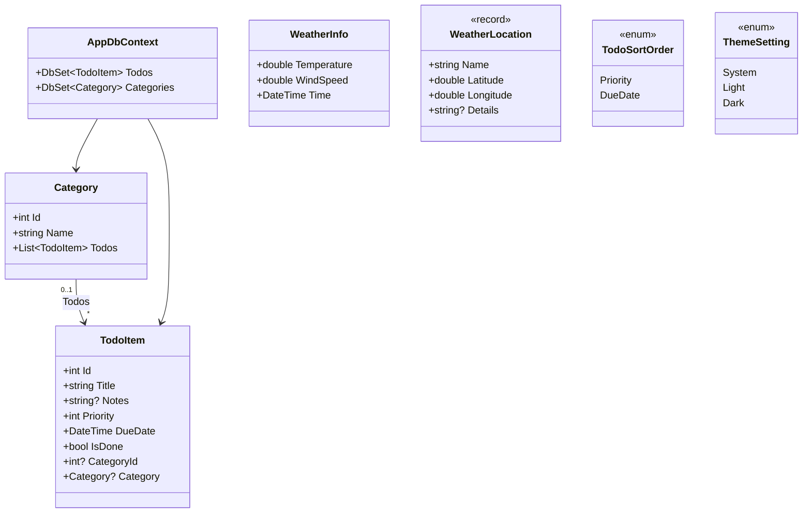
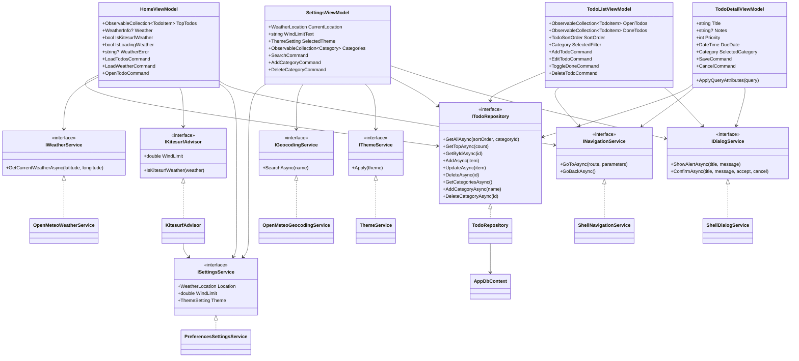

# LifeManagementApp

[](https://github.com/TonyThesslund/LifeManagementApp/actions/workflows/build.yml)

A .NET MAUI app that combines a to-do list with the current weather and tells you when it's kitesurfing weather.

## Goals

| Area | Goal |
|------|------|
| Home page | Top 3 unfinished to-dos (priority high→low, then due date earliest first), current weather (temperature + wind in m/s), and a "🪁 Kitesurf weather!" notice when wind > 5 m/s |
| To-do page | All to-dos in a `CollectionView`, sortable by priority or due date, button to add a new item |
| Add / edit | Form page; an empty title is rejected. Edit page gets the to-do id as a navigation parameter |
| Tech | MAUI + XAML, MVVM with CommunityToolkit.Mvvm, SQLite + EF Core Code First, HttpClient + Open-Meteo, dependency injection |
| Target | .NET 9 / MAUI 9, one class per file |

## Architecture

```
View (XAML)  →  ViewModel  →  Service (interface)  →  SQLite (EF Core) / Open-Meteo (HTTP)
```

- **Views** only bind to their ViewModel using compiled bindings (`x:DataType`). No logic in code-behind.
- **ViewModels** use `[ObservableProperty]` and `[RelayCommand]` and never reference UI controls.
- **Services** hold all data access and business rules behind interfaces, and are injected via DI in `MauiProgram`.

### Dependency injection lifetimes

| Registration | Lifetime | Why |
|--------------|----------|-----|
| `TodoRepository` | Singleton | Creates a new short-lived `AppDbContext` for each call through `IDbContextFactory`, so one shared repository is safe |
| `AppDbContext` | Factory | A `DbContext` isn't thread-safe and shouldn't live long, so the factory gives a new one per operation |
| `OpenMeteoWeatherService`, `OpenMeteoGeocodingService` | Typed `HttpClient` (transient) | `AddHttpClient` reuses connections through `IHttpClientFactory` and avoids running out of sockets |
| Settings, theme, kitesurf advisor, navigation, dialogs | Singleton | They hold no per-page state, or wrap something the whole app shares (`Preferences`, `Shell`) |
| `HomePage`, `TodoListPage`, `SettingsPage` + ViewModels | Singleton | Tab pages exist for as long as the app runs, so they keep their state when switching tabs |
| `TodoDetailPage` + `TodoDetailViewModel` | Transient | Each add or edit gets a fresh empty form, so values from an earlier to-do never carry over |

## Class diagram

### Data model

`TodoItem` and `Category` are stored in SQLite with EF Core. Deleting a category keeps its to-dos and leaves them without a category.



### ViewModels and services

Each page has one ViewModel. ViewModels only know the service interfaces, and `MauiProgram` decides which class is behind each one.



## Project structure

```text
LifeManagementApp/
├── LifeManagementApp/              The app
│   ├── Models/                     TodoItem, Category, WeatherInfo, WeatherLocation, enums and Open-Meteo JSON classes
│   ├── Data/
│   │   └── AppDbContext.cs         EF Core database (SQLite)
│   ├── Services/                   Interfaces and their classes: repository, weather, geocoding, settings, theme, navigation, dialogs
│   ├── ViewModels/                 HomeViewModel, TodoListViewModel, TodoDetailViewModel, SettingsViewModel
│   ├── Views/                      HomePage, TodoListPage, TodoDetailPage, SettingsPage
│   ├── Converters/                 Priority color, due date text, sort order text, strikethrough for done to-dos
│   ├── Resources/Styles/           Colors.xaml (color theme) and Styles.xaml (shared styles)
│   ├── AppShell.xaml               Tabs and routes
│   └── MauiProgram.cs              Dependency injection setup
├── LifeManagementApp.Tests/        xUnit tests, with fake services in Fakes/
├── .github/workflows/build.yml     Windows and Mac builds and tests on GitHub Actions
└── global.json                     Pins the .NET 10 SDK
```

## Running the app

The Windows app can only be built on Windows and the Mac app only on a Mac. The unit tests run on both.

`global.json` pins the .NET 10 SDK: newer SDKs refuse to build .NET MAUI 9 apps for the Mac.

### Windows

1. Install Visual Studio 2022 or newer with the **.NET Multi-platform App UI development** workload
2. Open `LifeManagementApp.sln` and run the `LifeManagementApp` project, or from a terminal:
   ```
   dotnet build LifeManagementApp/LifeManagementApp.csproj -t:Run -f net9.0-windows10.0.19041.0
   ```

### Mac

1. Install **Xcode 26.5**, the version the .NET MAUI 9 Mac tools require (they don't work with Xcode 27). The App Store has a newer one, so download the `.xip` from https://developer.apple.com/download/all (free Apple ID). Unpack it, rename it to `Xcode-26.5.app` so it can sit next to a newer Xcode, and move it to Applications. Then make it the active Xcode and finish its setup:
   ```
   sudo xcode-select -s /Applications/Xcode-26.5.app
   sudo xcodebuild -license accept
   xcodebuild -runFirstLaunch
   ```
   `xcode-select -p` should now print `/Applications/Xcode-26.5.app/Contents/Developer`. If it prints `/Library/Developer/CommandLineTools`, the build can't find Xcode. To go back to a newer Xcode for other projects, run `xcode-select -s` with that one.
2. Install the **.NET 10 SDK** from https://dotnet.microsoft.com/download (Arm64 for Apple Silicon Macs)
3. Install the MAUI workload:
   ```
   sudo dotnet workload install maui
   ```
4. In the repository folder, build and start the app:
   ```
   dotnet build LifeManagementApp/LifeManagementApp.csproj -t:Run -f net9.0-maccatalyst
   ```

If the build says the Xcode version doesn't match, install the version it names from the same page.

### Tests

```
dotnet test LifeManagementApp.Tests
```

## AI use

I used **Claude Code** by Anthropic (with the Claude Opus model) as an AI assistant during the project, in four areas:

- **General coding assistance**: help with setting up the project, suggesting how to structure classes and finding the cause of build errors and bugs
- **Test cases**: help with writing xUnit tests for the repository, ViewModels, converters and weather service and with finding cases the tests didn't cover yet, such as empty titles, network errors and the wind limit
- **UI refinement**: help with the color theme, shared styles, page layouts, light and dark mode, and making the app look right on both Windows and Mac
- **Documentation**: writing this README, including the class diagrams, the project structure, the DI lifetime table and the setup steps, as well as the GitHub issue descriptions

How I checked the AI's work:

- Read through every suggested change before keeping it, and asked for an explanation of anything I didn't understand
- Built and ran the app on Windows and Mac to see that changes worked
- Ran the unit tests after each change, and GitHub Actions built and tested every pull request

## Work order

Each step is a GitHub issue with sub-issues, done in a feature branch (`<issue#>-short-name`) and merged to `main` with a pull request that closes the issues. From step 7 on, each step also adds xUnit tests for the logic it introduces.

| # | Step | Contents |
|---|------|----------|
| 1 | Project setup | MAUI project on .NET 9, folder structure, NuGet packages (CommunityToolkit.Mvvm, EF Core Sqlite), Shell with tabs |
| 2 | Models + database | `TodoItem`, `Category` (1–N), `AppDbContext`, database created on startup |
| 3 | Repository | `ITodoRepository` / `TodoRepository` with async add, query, update, delete, sorting and top 3 |
| 4 | Dependency injection | Services, pages and ViewModels registered in `MauiProgram` |
| 5 | To-do list page | `CollectionView`, sort by priority / due date |
| 6 | Add / edit page | `TodoDetailPage` with title validation, edit via id parameter |
| 7 | Test project | xUnit project, app gets a plain `net9.0` target, tests for the repository and `TodoDetailViewModel` |
| 8 | Weather service | Open-Meteo client, JSON → `WeatherInfo`, m/s unit, error handling, kitesurf rule, tests for JSON mapping, errors and wind limit |
| 9 | Home page | Top 3 to-dos, weather, kitesurf alert, loading state |
| 10 | Bindings + converters | `x:DataType` everywhere, converters (e.g. readable sort order, priority color) |
| 11 | Done, edit, delete *(bonus)* | Mark a to-do done, edit and delete it from the list with a checkbox and a delete button |
| 12 | Categories and filtering *(bonus)* | Category picker on the add/edit page, category filter on the to-do list |
| 13 | Settings page *(bonus)* | Settings tab: weather location (city search), kitesurf wind limit and light / dark theme, saved with `Preferences` |
| 14 | Remaining tests | Fill any gaps in test coverage |
| 15 | Manage categories *(bonus)* | Add and delete categories in Settings, pickers stay up to date |
| 16 | Mac support | Build and run on macOS, Windows and Mac builds on GitHub Actions |
| 17 | Styling and design | Color theme, shared styles, centered layout, page designs, app icon |
| 18 | Documentation | Final README: description, how to run, class diagram, AI use |

## Requirements checklist

**Core**
- [x] Home: top 3 unfinished to-dos (priority desc, due date asc)
- [x] Home: temperature + wind speed (m/s)
- [x] Home: kitesurf notice when wind > 5 m/s
- [x] To-do list in `CollectionView`
- [x] Sort by priority / due date
- [x] Add new to-do, empty title rejected
- [x] Fields: Id, Title, Priority 1–5, DueDate, IsDone

**Top levels**
- [x] Shell navigation + parameter to edit page
- [x] SQLite + EF Core Code First, Category 1–N TodoItem, async queries
- [x] Model/ViewModel/Service, interfaces, no logic in code-behind
- [x] `[ObservableProperty]`, `[RelayCommand]`, `ObservableCollection`, `x:DataType`, converter
- [x] Interfaces + pages/VMs via DI, lifetimes justified
- [x] Async HTTP, JSON → model, no-network message, loading indicator
- [x] Regular commits, README per template

**Bonus**
- [x] Issues + feature branches + PRs
- [x] Two extra features
- [x] xUnit tests
